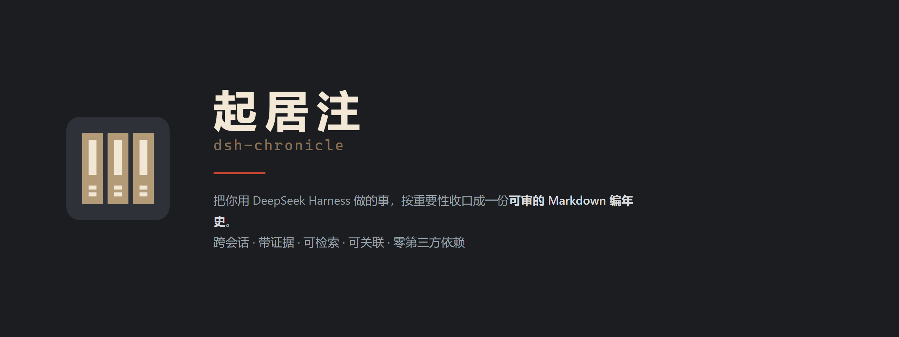

<p align="center">
  <picture>
    <source media="(prefers-color-scheme: dark)"
            srcset="https://raw.githubusercontent.com/zuoyunlai/dsh-chronicle/main/docs/brand/banner-dark.png">
    <source media="(prefers-color-scheme: light)"
            srcset="https://raw.githubusercontent.com/zuoyunlai/dsh-chronicle/main/docs/brand/banner-light.png">
    
  </picture>
</p>

# 起居注 · dsh-chronicle

每天把你用 DeepSeek Harness 做的事，按重要性收口成一份**可审的 Markdown 编年史**：跨会话、带证据、可检索、可关联。

产物是一个独立的 Obsidian vault，**零第三方依赖**——`dependencies` 为空，只声明宿主自带的 `@deepseek-ai/*`。

> **状态：v2.4.2**（P6）
> 采集 → 回捞 → 纲要 → 规则/LLM 打分 → **日结 + 七块** → 周文件 → 按天时间轴 → 实体图与实体页 → 事实库 → 跨天线索 → 规则导出 → 右侧栏面板。
> 176 条测试全绿。

---

## 它解决什么

- **反复解释同一件事**：上一轮敲定的方案、踩过的坑、否掉的路线，下一轮全都不在了。
- **记忆插件记不住「那天到底怎么了」**：写入式记忆没有「这条结论是哪天、从哪次对话得出的」这条链。
- **日报工具只有流水账**：不排序、不带证据、不可回溯。

## 它明确不做

- 不做向量语义检索、不做全量历史回填
- 不替代实时工作记忆（那是 mnemon / OpenViking 的地盘，本插件常驻只占一行 ≤80 token）
- 不 push 任何代码；`gitCommit` 只做本地提交

---

## 三层结构

| 层 | 目录 | 内容 |
|---|---|---|
| **编年体** | `chronicle/2026-W46.md` | 按周一个文件。每天一块：**日结 + 项目进展 / 结论与决策 / 约定与口径 / 坑与根因 / 被否方案 / 未答问题 / 其余进展** |
| **纪传体** | `entities/`、`graph/` | 实体页与共现图。面板「图谱」视图是它的可视化 |
| **纪事本末体** | `facts/`、`MEMORY.md` | **不随日期过期**的原子结论：决策 / 约定 / 坑 / 被否方案 / 未答问题。`MEMORY.md` 是索引，先读它再决定打开哪一篇 |

### 事实层的两个分区

事实分 `scope: general`（你的工作知识）与 `scope: tool-self`（记录工具自身的开发史）。

- `general` 进 `MEMORY.md` 主索引，也进规则导出
- `tool-self` 单独一节，**不进规则导出**

这样「工具开发笔记」和「工作记忆」可以共存而互不污染。

---

## 安装

**装法：在 DSH 的「设置 → 插件」里搜索 `dsh-chronicle` 安装。** 插件管理会同时做三件事：
装依赖、加进 `dsh.profile.bundles`、应用包内的 `cordis.patch.yml`。

命令行等价物：

```bash
dsh plugin --profile <你的 profile> add dsh-chronicle
```

⚠️ **`dsh plugin ... add` 只是转发给 pnpm，它只装包、不启用。**
装完必须再去「设置 → 插件」把这个插件**打开**，否则 `chronicle_*` 工具不会出现
（表现为「装着但工具全消失」）。

装完重启该 profile 的进程。然后在会话里问一句「chronicle 装好了吗」，
模型会调 `chronicle_ping` 自检，输出里能看到版本、数据目录、产物目录与宿主服务就绪情况。

---

## 工具（10 个）

| 工具 | 用途 |
|---|---|
| `chronicle_ping` | 自检：版本、目录、配置、服务就绪、回捞进度 |
| `chronicle_close` | 立刻收口某天（`scoring` 可单次覆盖 rule/llm，`dryRun` 只预览） |
| `chronicle_doctor` | 日志体检：行数、重复键、坏行、思考污染、丢弃计数 |
| `chronicle_today` | 取某天的记录，按重要度降序 |
| `chronicle_search` | 跨天检索（实体命中 + 图 2 跳 + IDF 词频 + 60 天半衰期） |
| `chronicle_related` | 给一个实体，返回图邻居与相关记录 |
| `chronicle_facts` | 事实库列举（可按 kind / project / q / scope 过滤） |
| `chronicle_review` | 该复核的旧结论（单次得出且久未复现，或带重评条件） |
| `chronicle_export_rules` | 把约定 / 失效条件 / 判别信号导出成可粘的规则 |
| `chronicle_capsule` | 时间胶囊：给未来的自己留一句话 |

## 面板

右侧栏「起居注」六个视图：**近期 / 检索 / 关联 / 事实 / 线索 / 图谱**。

- **近期**是按天的**时间轴**：每天一块 = 日期 + 星期 + 条数 → 当天日结 → 按板块分组的条目。
  缺日结时会提示怎么产出，不留白。
- **图谱**是零依赖的力导向图（滚轮缩放、拖背景平移、拖节点、双击复位），
  点绿点进事实库、点褐/黄点进检索。

---

## 数据放哪

| 目录 | 内容 | 删了会怎样 |
|---|---|---|
| `~/.dsh/dsh-chronicle/`（可配） | 原始事件 JSONL、状态、纲要缓存 | **不可重建** |
| `~/dsh-chronicle-vault/`（可配） | 周文件 Markdown、实体页、事实页、规则导出 | **可重跑**，Obsidian 直接打开这一层 |

两者刻意分开：库可以随手删，数据不行。

---

## 权限（它能做什么 / 不能做什么）

插件在 `package.json` 的 `dsh.capabilities` 里声明了它用到的宿主面：

| 能力 | 用在哪 |
|---|---|
| `tools:register` | 注册 10 个 `chronicle_*` 工具 |
| `sessions:read` | 后台回捞读历史会话（只读，不改写任何会话） |
| `system-prompt:write` | 往系统提示里追加**一行**摘要（见下方披露） |
| `fs:read` | 读自己的数据目录 |
| `network:egress` | 面板客户端 `fetch` 同源的 `/chronicle/api/*`（同源、只读、仅回环） |

`dsh.labels` 标了 `prompt-modification`——因为确实会动系统提示。

### 它不做的事（`dsh.commitments` 里逐条声明）

- **不上传会话**：事件只写本机 `events/*.jsonl`。唯一例外是 `scoring: llm`（默认关）——
  它把当天**纲要**（每轮用户 ≤160 字 / 助手 ≤100 字）交给宿主 `llm` 服务做一次打分，
  provider 跟随你当前选择的模型，插件不写死任何地址；详见 `dsh.disclosure.llmEgress`
- **不经过第三方中转**：没有第三方端点（`disclosure.endpoints` 为空数组）
- **不读凭据**：从不碰 `ctx.credentials`
- **不静默改改写提示**：只追加一个登记过的 context 块，见下方披露
- **不注册 LLM adapter / webhook**，**不接管** shell / credentials / sandbox 这些安全缝
- **不硬编码沙箱绕过**

### 往你的提示里注入了什么（`dsh.disclosure.systemPrompt`）

常驻**一行**，不超过 `injectBudget` 字符（默认 80）：

```
[chronicle] 今天 12 条 · 一条约定与一个待避的坑
```

优先取「与最近在做的事同项目」的一条约定/决策 + 一个该避的坑；没有可用事实时退回当天条目数。
当天没有记录时**整行不出现**。关掉：配置里 `injectLine: false`。

### 数据保留（`dsh.disclosure.retention`）

全部留在本机，插件不自动上传。`keepDays=0`（默认）时**也不自动删除**，清理要你自己动手；
把它设成正整数才会按天清理 `events/`（`facts/` 与产物永不自动删）。

---

## 配置

21 项，在「设置 → 插件 → 起居注」里改。常用的：

| 键 | 默认 | 说明 |
|---|---|---|
| `vaultDir` | `~/dsh-chronicle-vault` | 产物目录，Obsidian 直接打开这层 |
| `dataDir` | `$DSH_HOME/dsh-chronicle` | 私有数据；留空即默认 |
| `tickMinutes` | `5` | 轮询间隔。只判断「该不该收口」 |
| `importanceFloor` | `3` | 低于这个星级折叠进附录 |
| `scoring` | `rule` | `rule` 不调模型但没有日结；`llm` 才有日结 |
| `followModel` | `true` | 打分跟随当前选中模型 |
| `scoringModel` | 空 | 固定打分模型，形如 `provider/model`；仅 `followModel=false` 时生效 |
| `gitCommit` | `true` | 收口后对 vault 做本地 commit（**只 commit 不 push**） |
| `injectLine` | `true` | 是否注入那一行摘要 |
| `injectBudget` | `80` | 注入行的**字符**上限（含 `[chronicle]` 前缀） |
| `llmTimeout` | `120` | LLM 打分超时（秒）；超时退回规则分，不会卡住收口 |
| `redact` | `true` | 落盘前脱敏凭据 |
| `maxEventsPerDay` | `5000` | 单日事件上限，超出会计数并报出 |
| `entityRule` | `on-hit` | 实体页门槛：`on-hit` / `score` / `always` |
| `uiLocale` | `auto` | 面板语言：`auto` / `zh` / `en` |
| `weekFile` | `true` | 按周一个文件；关掉退回按天（一年 365 个文件会拖垮 Obsidian） |
| `includeSubagent` | `false` | 是否收录子代理会话 |
| `panelGuard` | `loopback` | 面板路由只接受回环 peer + 回环 Host 的 GET；`off` 仅在局域网访问且知情时用 |
| `keepDays` | `0` | `>0` 时自动清理这么久之前的 `events/*.jsonl`（0 = 永不清理） |

完整清单见 `chronicle_ping` 输出或设置页。

---

## 升级与卸载

**升级**（在 DSH 的「设置 → 插件」里点更新，或命令行）：

```bash
dsh plugin --profile <profile> add dsh-chronicle@latest
```

升级**不动你的数据**：`dataDir` 与 `vaultDir` 都在插件目录之外，换版本不影响。
装完重启该 profile 的进程。

**卸载**：

```bash
dsh plugin --profile <profile> remove dsh-chronicle
```

卸载**不会**删你的数据与产物。要彻底清掉，手动删这两个目录：

```bash
rm -rf ~/.dsh/dsh-chronicle ~/dsh-chronicle-vault
```

> 卸载前建议先跑一次 `chronicle_ping` 确认数据目录在哪——`dataDir` 可能被改过。

---

## 常见问题

**工具全消失，但设置页里还看得到插件**
最常见的原因是「装了但没启用」。`dsh plugin ... add` 只把包装进 profile，
不会加进 `dsh.profile.bundles`。去「设置 → 插件」把它打开，再重启进程。

**面板空白 / 404**
先跑 `chronicle_ping` 看「面板 API 已注册 N 条」。0 条说明路由没注册上，
重启一次；仍然 0 条就把 `chronicle_ping` 的输出发出来。

**日结是空的**
默认档位 `scoring: 'rule'` **不产日结**（不调模型，只做机械打分）。
要日结就把它改成 `llm`，或收口时指定：`chronicle_close { "day": "2026-11-09", "scoring": "llm" }`。

**今天怎么还没有记录**
收口在**跨过午夜后**收「上一个自然日」，不收今天——因为只有过了 00:00，
「这一天过完了吗」才有确定答案。今天的数据在 `chronicle_ping` 的「今日 N 条」里看得到。

**电脑关着，那天的日结会丢吗**
不会。下次启动第一件事就是补收，与关了几小时无关。一次最多补 30 天；
更早的会在 `chronicle_ping` 的 `catchUpDropped` 里列出来。

**事件被丢了（`dropped` 不为 0）**
单日超过 `maxEventsPerDay`（默认 5000）。调大它，或看 `chronicle_doctor` 的分布确认是不是异常。

**收了口但某个会话没进**
那个会话的正文可能超时被跳过了。`chronicle_doctor` 会报；也可以等后台回捞补，
补完后若事件文件变了，下次 tick 会自动重收，并在 ping 的 `revisited` 里列出。

---

## 已知边界

- **两个能力是动态获取的**：`system-prompt:write` 与 `sessions:read` 通过
  `ctx.inject([...], injected => injected.get(...))` 拿服务，不是直接写 `ctx.systemPrompt.x()`，
  所以 DSH 静态扫描器看不到触发点（官方检查报 C-11.5「declared but not observed」）。
  声明是准确的，代码里确实在用；这是扫描器的静态边界，不是多声明。

- **事件上限**：单日 5000 条（可配）。超出会计数并在 `chronicle_doctor` 报出。
- **收口时机**：**跨过午夜后收「上一个自然日」**，不收当天——收口的本质是问「这一天过完了吗」，
  只有过了 00:00 才有确定答案。电脑关着不会丢数据：下次启动第一件事就是补收。
  一次最多补 30 天，更早的会在 `chronicle_ping` 的 `catchUpDropped` 里报出来。
- **重收**：某天已收口后，若后台回捞又补进了那天的旧会话，事件文件会更新，
  下次 tick 自动重收，并在 ping 的 `revisited` 里列出。
- **规则导出**：按 `project` 分节（通用条目排最前），可用 `project` 参数只导出某个项目的规则。
- **面板检索不记命中**：面板是只读面，GET 不带写盘副作用。命中计数只由 `chronicle_search` 累加。
- **跨宿主版本**：`plugin_doctor` 的 X1（peer 走廊）用的是过期基线，实测宿主 0.2.2-rc.1 满足 `^0.2.1-rc.1`，**不需要改**。
  `dsh.client.inject` 里的 `@deepseek-ai/dsh-client-ui-slots` 是宿主运行时提供的逻辑模块（不是 npm 包），
  `dsh-better-sidebar` / `dsh-rightbar-quicknav` 同样这么声明，**不要删**。

## 规划与决策

完整方案见 [`docs/PLAN.md`](docs/PLAN.md)；2026-11-10 的全量审计见 [`docs/AUDIT-2026-11-10.md`](docs/AUDIT-2026-11-10.md)（46 个问题与逐条修法）。

## 发版（Releasing）

### 日常发版：推 tag 即可

```bash
# 1) 改版本：package.json / index.js / client.js 的 VERSION / CHANGELOG / README 五处一致
# 2) 提交
git commit -am "rel: vX.Y.Z"
git push

# 3) 打 tag 并推 —— 这一步触发 CI 发布
git tag -a vX.Y.Z -m "vX.Y.Z" && git push origin vX.Y.Z
```

`publish.yml` 会：跑测试 → 探测 npm 上是否已有该版本（**有就跳过**，幂等）→ OIDC 发布 → 建 GitHub Release（附 tarball）。

认证走 **OIDC Trusted Publishing**，仓库里不存任何 npm token。

### 三个环境坑（本机实测）

**① 本机默认 registry 是 npmmirror 镜像，不能发布**

```
registry = https://registry.npmmirror.com
```

但 `package.json` 的 `publishConfig.registry` 已写死官方源，所以 `npm publish` 会**自动走 registry.npmjs.org**，
不需要手动加 `--registry`，也不会被镜像带偏。

**② npm 账号与 GitHub 账号不是同一个**

npm 是 `zhuoerbufan`，GitHub 是 `zuoyunlai`。配 Trusted Publisher 时填的是 **GitHub 的仓库信息**，
与 npm 用户名无关。

**③ 本机 `github.com:443` 不通，但 SSH（22）和 api.github.com 正常**

```bash
# 拉取/推送一律走 SSH
git remote set-url origin git@github.com:zuoyunlai/dsh-chronicle.git
```

`git push` 走 https 会 21 秒超时。

### 首次发布必须手动（npm 的已知限制）

npm **不支持为尚不存在的包预配置 Trusted Publisher**——配置入口在
`npmjs.com/package/<name>/settings`，包不存在就没有那个页面。
见 [npm/documentation#1926](https://github.com/npm/documentation/issues/1926)（open）与
[npm/cli#8544](https://github.com/npm/cli/issues/8544)（"first publish 不在 MVP 里"）。

```bash
npm login --registry=https://registry.npmjs.org/   # 浏览器流程
npm publish                                        # 会提示输入 2FA 验证码
```

首发完成后，到 https://www.npmjs.com/package/dsh-chronicle/settings → Trusted publishing 添加：

| 字段 | 值 |
|---|---|
| Provider | GitHub Actions |
| Organization or user | `zuoyunlai` |
| Repository | `dsh-chronicle` |
| Workflow filename | `publish.yml` |
| Environment | 留空 |

之后所有版本都可以只靠推 tag。

## License

MIT
